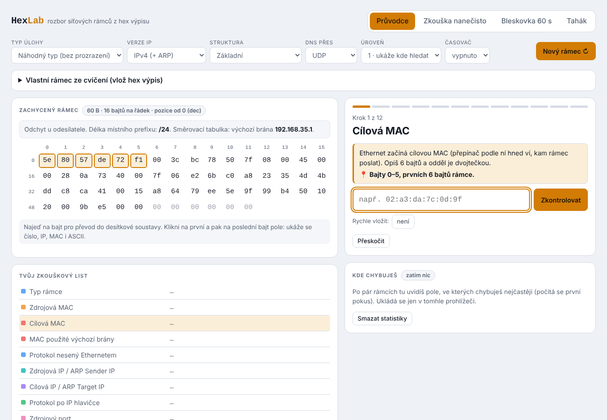

# HexLab: trenažér rozboru síťových rámců

Webový trenažér, na kterém se připravuju na zápočet z **Počítačových sítí** (PEF MENDELU). Na zápočtu dostaneme hex výpis zachyceného rámce a máme z něj vyčíst MAC adresy, IP adresy, protokoly, porty a typ zprávy. K tomu je potřeba rychle převádět čísla mezi šestnáctkovou a desítkovou soustavou. Tak jsem si udělal nástroj, kde to můžu trénovat pořád dokola.

**▶ Vyzkoušej:** stačí otevřít `index.html` v prohlížeči (nebo přes GitHub Pages).

## Režimy

- **Průvodce:** krok za krokem přes celý rámec, s nápovědou, kde v hex výpisu hledat. Tři úrovně obtížnosti.
- **Zkouška nanečisto:** vyplníš celý „zkouškový list“, volitelně na čas (5/8/12 min).
- **Bleskovka 60 s:** co nejvíc převodů hex → desítkově, portů, EtherTypů a příznaků za minutu, s rekordem.
- **Tahák:** mapa pozic bajtů, číselníky, postup a pravidla pro výchozí bránu.

## Co generuje

Náhodné, ale realistické rámce: Ethernet II / 802.3, VLAN 802.1Q, IPv4 i IPv6 (včetně voleb a rozšiřujících hlaviček), ARP, ICMP/ICMPv6 (NDP), TCP handshake, DNS přes UDP/TCP, HTTP. Kontrolní součty jsou dopočítané správně.

Do HexLabu jde vložit i **vlastní rámec ze cvičení**, třeba výpis z Wiresharku.

## Další vychytávky

- Po kliknutí na bajty se vybraný úsek převede na číslo, IP, MAC i ASCII.
- **Statistika chyb:** ukáže, ve kterých polích chybuju nejčastěji. Ukládá se jen v prohlížeči.
- Světlý i tmavý režim, funguje i na mobilu.

## Technologie

Čisté HTML + CSS + JavaScript v jednom souboru, bez knihoven a bez serveru.
